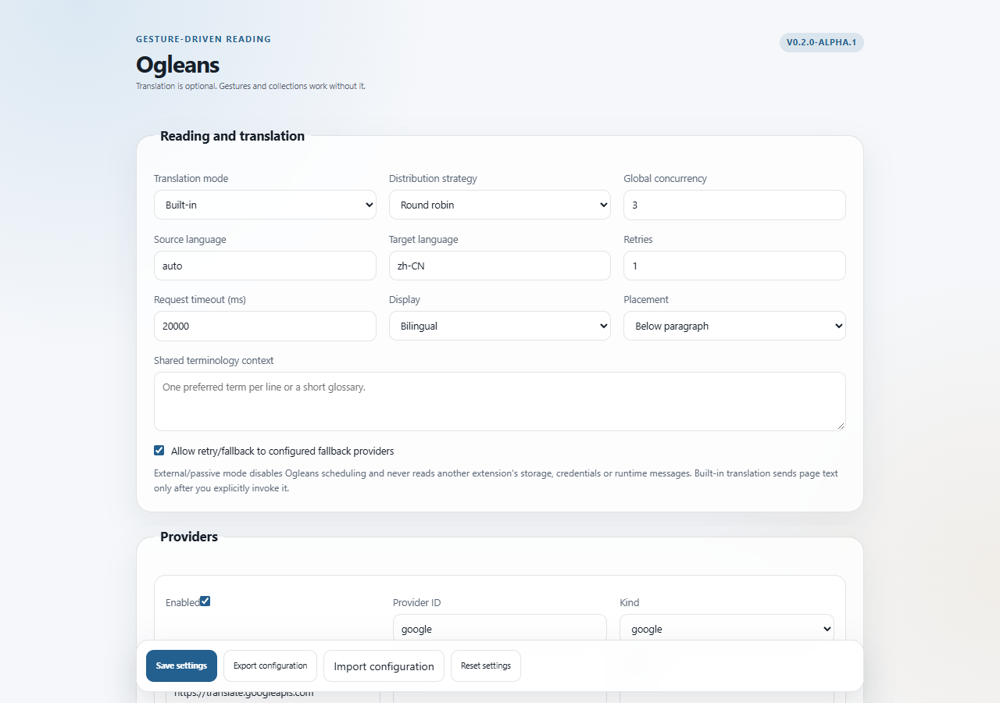
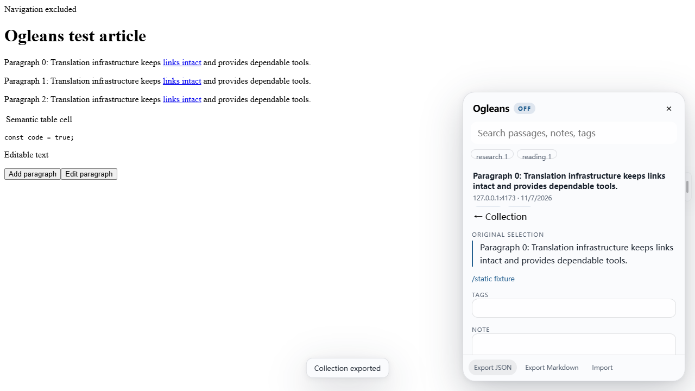
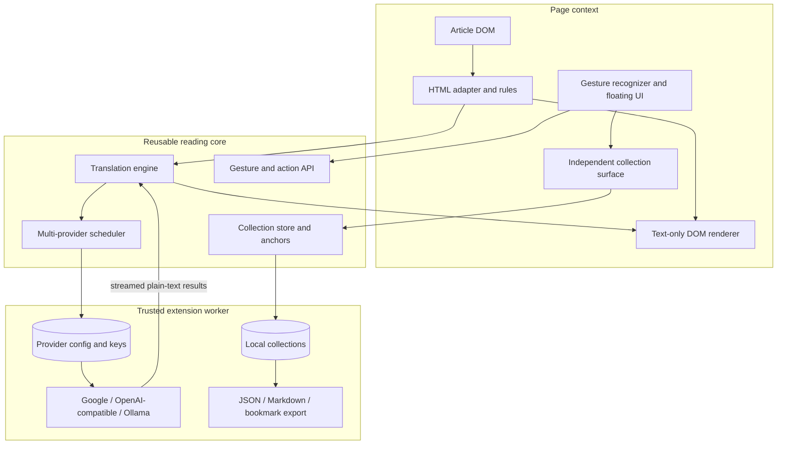

# Ogleans

[简体中文](README.zh-CN.md) · [CI](https://github.com/styayur/ogleans/actions) · [Roadmap](https://github.com/styayur/ogleans/issues/24) · [Releases](https://github.com/styayur/ogleans/releases)

**Ogleans is a lightweight, gesture-driven browser reading layer with optional composable translation and independent local collections.**

Project stage: `v0.2.0-alpha.1`, Chromium MV3 validation only. Firefox packaging is not validated and is not claimed as supported.





The screenshots come from the real Chromium extension E2E suite in a fresh test profile.

## Why Ogleans exists

Most translation extensions make reading interaction, translation and saved text one inseparable system. Ogleans separates them:

1. **Gesture layer** — configurable mouse gestures, floating controls, keyboard alternatives and reading navigation.
2. **Translation layer** — optional paragraph scheduling across multiple providers, with concurrency, rate limits, cancellation, retry, fallback and reversible rendering.
3. **Collection layer** — original/displayed selection capture, W3C-compatible annotations, anchors, tags, notes, search, import/export and optional bookmark export.

The translation engine is replaceable. You can use another translation extension, choose passive external mode, or disable Ogleans translation completely. Gestures, selections, collections, annotations, search and exports continue to work.

## Architecture

<!-- architecture:overview:start -->



<!-- architecture:overview:end -->

The page never receives provider secrets. The content script gets public settings only. Provider calls are made in the trusted service worker. Collection data is local until the user explicitly exports it.

See [ARCHITECTURE.md](ARCHITECTURE.md) for the full layer contracts and failure behavior.

## Translation modes

| Mode       | Built-in scheduling | Gesture layer | Collections | Selection behavior                                                              |
| ---------- | ------------------- | ------------- | ----------- | ------------------------------------------------------------------------------- |
| `built-in` | Active              | Active        | Active      | Original text and Ogleans translation provenance when available                 |
| `external` | Off                 | Active        | Active      | Saved as a displayed selection; Ogleans never claims the original was recovered |
| `disabled` | Off                 | Active        | Active      | Normal page selection capture                                                   |

Ogleans does not inspect another extension's storage, credentials or private runtime messages. There is no universal cross-extension translation API, so external compatibility is passive. See [external translation mode](docs/external-translation.md).

## Installed features

- Borderless floating selection controls and a minimal collection handle.
- Configurable mouse gesture registry with conflict detection and keyboard alternatives.
- Mouse gesture recognition that distinguishes movement from ordinary clicks.
- Native context menu preservation unless the user explicitly configures a right-button gesture, in which case only an intentional gesture suppresses that one menu.
- Concurrent paragraph scheduling across multiple providers.
- Round-robin, weighted, language-aware, manual and primary/fallback strategies.
- Provider concurrency, request windows, global concurrency, retries, timeouts, fallback and cancellation.
- Streaming partial results while preserving final paragraph order.
- Bounded cache with source/target/terminology-aware keys.
- Independent collection store with W3C-compatible annotation structures.
- Quote and position selectors plus Text Fragment navigation links.
- Search, tags, notes, editing, deletion, JSON import/export and Markdown export.
- Optional native browser bookmark export that preserves existing bookmarks and never deletes them.
- Permission-free HTML bookmark export fallback.
- v1 configuration migration and legacy collection-key migration support.

## Default gestures

Mouse trigger: **Alt + primary drag**. Gestures are configurable in settings.

| Gesture          | Action                        |
| ---------------- | ----------------------------- |
| `up`             | Save selection                |
| `down`           | Open collection               |
| `left` / `right` | Previous / next saved passage |
| `up,right`       | Toggle built-in translation   |
| `right,up`       | Cycle display mode            |
| `down,right`     | Restore original text         |
| `down,left`      | Open dictionary               |
| `left,right`     | Hide panel                    |

Keyboard alternatives:

| Shortcut                             | Action                             |
| ------------------------------------ | ---------------------------------- |
| `Alt+Shift+S`                        | Save selection                     |
| `Alt+Shift+C`                        | Open collection                    |
| `Alt+Shift+Left` / `Alt+Shift+Right` | Previous / next passage            |
| `Alt+Shift+T`                        | Toggle built-in translation        |
| `Alt+Shift+M`                        | Cycle display mode                 |
| `Alt+Shift+R`                        | Restore original                   |
| `Alt+Shift+D`                        | Open dictionary                    |
| `Alt+Shift+H`                        | Hide panel                         |
| `Escape`                             | Close the focused collection panel |

Global browser shortcuts can be changed at `chrome://extensions/shortcuts`.

## Collection behavior

A collection item preserves the selected text, optional original text, source URL/title/author, capture kind, translations and provider provenance, tags, notes, timestamps, a robust text anchor and bookmark-export metadata. The annotation is represented with W3C Web Annotation-compatible `TextQuoteSelector` and `TextPositionSelector` objects.

If the selected text came from a translation, Ogleans records it as a displayed translation/selection. If another extension supplied the visible text and Ogleans cannot identify the original, the item explicitly says so. A changed page can make an old anchor unavailable; the item remains readable and the UI reports the limitation rather than promising perfect restoration.

See [collection schema](docs/collection-schema.md) and [annotation and anchor specification](docs/annotation-anchors.md).

## Providers and scheduling

Provider examples:

| Kind              | Example endpoint                   | Notes                                                     |
| ----------------- | ---------------------------------- | --------------------------------------------------------- |
| Google            | `https://translate.googleapis.com` | Keyless convenience endpoint; unofficial and rate-limited |
| OpenAI-compatible | `https://provider.example/v1`      | `/chat/completions`, model and optional key/headers       |
| Ollama-compatible | `http://127.0.0.1:11434`           | Local `/api/chat` JSON output                             |

The scheduler assigns each paragraph to one provider at a time. It does not send the same paragraph concurrently to every provider. A configured fallback may be attempted after retry exhaustion. Provider limits and the global semaphore prevent unbounded fan-out. Completed paragraphs are rendered immediately; the final document order is always the source order.

See [provider scheduling](docs/provider-scheduling.md).

## Privacy and security

- Provider API keys and custom headers stay in the trusted extension worker.
- Content scripts never receive secrets.
- Translation happens only after an explicit user action.
- Provider requests reject redirects and omit browser credentials.
- Translation output is text, never executable markup.
- Collection data stays in local extension storage until exported.
- Exports omit provider credentials and custom secret headers.
- Browser bookmark permission is optional and requested only when enabled.
- Ogleans does not request persistent all-site host access; provider origins remain optional.
- There is no telemetry, cloud sync or remote JavaScript.

Read [SECURITY.md](SECURITY.md) and [license boundaries](docs/licensing.md).

## Install

1. Download `ogleans-chromium-v0.2.0-alpha.1.zip` from [Releases](https://github.com/styayur/ogleans/releases).
2. Extract it and open `chrome://extensions`.
3. Enable Developer mode and choose **Load unpacked**.
4. Select the extracted folder containing `manifest.json`.
5. Open settings to choose translation mode, provider policies and gestures.
6. Open an ordinary HTTP(S) article. Use the extension popup, a shortcut or a configured gesture to activate Ogleans.

The Chrome Web Store is not part of this alpha. Restricted browser pages cannot be read.

## Development

```sh
pnpm install
pnpm exec playwright install chromium
pnpm check
pnpm format:check
pnpm benchmark
```

`pnpm check` runs lint, strict typecheck, unit/DOM/lifecycle tests, production builds, SDK/example verification and the real Chromium extension E2E suite.

## Public APIs and packages

```text
packages/gesture/       configurable recognition, conflict detection, keyboard alternatives
packages/scheduler/     multi-provider assignment, bounds, rate limits, retry/fallback
packages/translation/   streaming translation coordinator and scheduler transport
packages/collection/    collection schema, local store, anchors, search, import/export
packages/sdk/           public exports for all reusable layers
packages/core/          v1 TranslationKernel retained for compatibility
packages/dom/           HTML adapter, mutation reconciliation and anchors
packages/renderer/      text-only translation rendering and restore
packages/provider-api/  ProviderRouter compatibility plus validation
packages/shared/        versioned document and translation contracts
apps/browser-extension/ Chromium MV3 composition
```

Read [Gesture API](docs/gesture-api.md), [Provider scheduling](docs/provider-scheduling.md), [Provider API](docs/provider-api.md), [Adapter API](docs/adapter-api.md), [Event API](docs/event-api.md), [Action API](docs/action-api.md) and [Collection schema](docs/collection-schema.md).

## Migration from Translation Kernel v0.1

- `schemaVersion: 1` configuration is migrated to `schemaVersion: 2` automatically.
- Existing provider, language, display, rule and action fields are preserved.
- Legacy collection keys are read if present.
- The richer configuration can be exported before moving an unpacked extension to a different folder. Chrome unpacked extension IDs can change when the install path changes.
- Translation spans are not persistent page data and do not need migration.

See [v0.2 migration](docs/migration-v0.2.md).

## Compatibility and limitations

- Chromium 120+ is the validated browser line.
- Firefox packaging is not validated and is not claimed.
- External translation extensions cannot be universally controlled; Ogleans ships passive coexistence, not private interop.
- Cross-origin iframes and shadow roots are outside the current page adapter.
- Text anchors cannot guarantee restoration after arbitrary page changes.
- Provider quality, availability and cost are external concerns.
- Image, PDF, EPUB, OCR, audio, AI chat, accounts, vocabulary training and cloud sync are intentionally out of scope.

## Documentation

- [Architecture](ARCHITECTURE.md)
- [Gesture API](docs/gesture-api.md)
- [Provider scheduling](docs/provider-scheduling.md)
- [External translation mode](docs/external-translation.md)
- [Collection schema](docs/collection-schema.md)
- [Annotation and anchors](docs/annotation-anchors.md)
- [Bookmark integration](docs/bookmark-integration.md)
- [Migration](docs/migration-v0.2.md)
- [Browser E2E report](docs/e2e-report.md)
- [Performance](docs/performance.md)
- [Verification](docs/verification.md)

## License

Reusable packages, SDK, examples, documentation and test/build support are **MPL-2.0**. The browser application under `apps/browser-extension/` and its distributed bundle are **GPL-3.0-or-later**. Third-party dependencies retain their original licenses. See [NOTICE](NOTICE), [THIRD_PARTY.md](THIRD_PARTY.md) and [license boundaries](docs/licensing.md).
