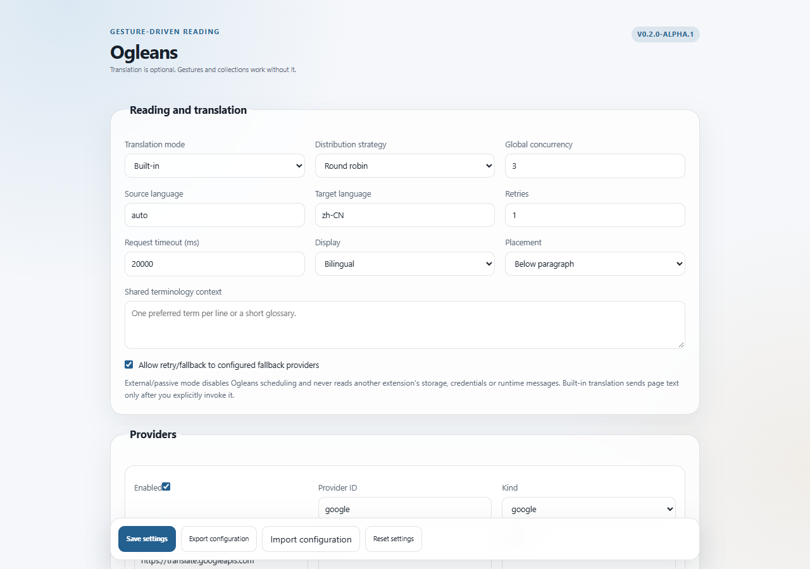
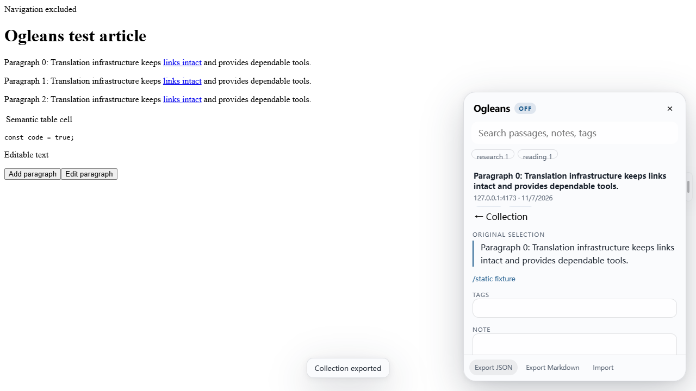

# Ogleans

[English](README.md) · [CI](https://github.com/styayur/ogleans/actions) · [路线图](https://github.com/styayur/ogleans/issues/24) · [发布版本](https://github.com/styayur/ogleans/releases)

**Ogleans 是一个轻量、手势驱动的浏览器阅读层，内置可选的可组合翻译能力，并提供独立的本地文本收藏系统。**

当前阶段：`v0.2.0-alpha.1`，仅验证 Chromium MV3。Firefox 打包尚未独立验证，因此不宣称支持 Firefox。





截图来自真实的 Chromium 扩展端到端测试环境。

## 设计目标

Ogleans 将阅读交互、翻译和收藏明确拆分为三个可独立使用的层：

1. **手势层**：可配置鼠标手势、浮动控件、键盘替代操作和阅读面板导航。
2. **翻译层**：可选的段落级多提供商调度，支持并发、速率限制、取消、重试、回退和可逆渲染。
3. **收藏层**：原文/当前显示文本捕获、W3C 兼容注解、文本锚点、标签、笔记、搜索、导入导出和可选书签导出。

翻译引擎是可替换的。用户可以继续使用其他浏览器翻译扩展，选择被动外部模式，或完全关闭 Ogleans 翻译。手势、文本选择、收藏、注解、搜索和导出仍然可用。

## 翻译模式

| 模式       | Ogleans 内置调度 | 手势 | 收藏 | 文本捕获                                 |
| ---------- | ---------------- | ---- | ---- | ---------------------------------------- |
| `built-in` | 启用             | 启用 | 启用 | 可用时保存原文和翻译来源                 |
| `external` | 关闭             | 启用 | 启用 | 作为“当前显示选择”保存，不假装恢复了原文 |
| `disabled` | 关闭             | 启用 | 启用 | 捕获页面中的当前选择                     |

Ogleans 不会读取其他扩展的存储、凭据或私有运行时消息。浏览器扩展之间没有通用的翻译控制 API，因此外部兼容性采用被动共存模式。详见[外部翻译模式](docs/external-translation.md)。

## 核心能力

- 无边框浮动选择工具条和轻量收藏入口。
- 可配置手势注册表、冲突检测和键盘替代操作。
- 区分有意图的手势与普通点击。
- 默认不拦截右键菜单；只有用户显式配置右键手势并完成有意图的移动后才抑制该次菜单。
- 多提供商并行段落调度，同时保留原始段落顺序。
- 轮询、加权、语言感知、手动分配和主/回退策略。
- 全局并发、提供商并发、请求窗口、超时、重试、回退和取消。
- 部分结果实时渲染，单个提供商失败不会清空其他成功结果。
- 有界缓存，缓存键包含源/目标语言、术语上下文和原文。
- 独立收藏存储，兼容 W3C Web Annotation 结构。
- TextQuoteSelector、TextPositionSelector 和 Text Fragment 导航。
- 搜索、标签、笔记、编辑、删除、JSON 导入导出和 Markdown 导出。
- 可选浏览器书签导出，保留已有书签且不删除任何书签。
- 无权限依赖的 HTML 书签文件回退。
- v1 配置迁移和旧收藏键迁移。

## 默认手势

鼠标触发：**Alt + 主键拖动**，可在设置中修改。

| 手势             | 操作                |
| ---------------- | ------------------- |
| `up`             | 保存选择            |
| `down`           | 打开收藏            |
| `left` / `right` | 上一条 / 下一条收藏 |
| `up,right`       | 切换内置翻译        |
| `right,up`       | 切换显示模式        |
| `down,right`     | 恢复原文            |
| `down,left`      | 打开词典            |
| `left,right`     | 隐藏面板            |

键盘替代：

| 快捷键                               | 操作            |
| ------------------------------------ | --------------- |
| `Alt+Shift+S`                        | 保存选择        |
| `Alt+Shift+C`                        | 打开收藏        |
| `Alt+Shift+Left` / `Alt+Shift+Right` | 上一条 / 下一条 |
| `Alt+Shift+T`                        | 切换内置翻译    |
| `Alt+Shift+M`                        | 切换显示模式    |
| `Alt+Shift+R`                        | 恢复原文        |
| `Alt+Shift+D`                        | 打开词典        |
| `Alt+Shift+H`                        | 隐藏面板        |
| `Escape`                             | 关闭收藏面板    |

全局浏览器快捷键可在 `chrome://extensions/shortcuts` 修改。

## 多提供商并发

调度器为每个段落只分配一个提供商，不会在未声明比较模式时同时向多个提供商发送同一段落。失败后按配置顺序进行重试和回退。全局并发信号量和提供商请求窗口限制网络请求数量。完成结果可以先渲染，但最终顺序始终与原文一致。

支持：

- 轮询：`round-robin`
- 平滑加权轮询：`weighted`
- 语言感知：`language-aware`
- 手动分配：`manual`
- 主提供商与回退：`primary-fallback`

详见[提供商调度规范](docs/provider-scheduling.md)。

## 收藏数据

每个收藏条目保存：

- 稳定 ID
- 当前选择文本和可用的原文
- 来源 URL、标题、作者和源语言
- 翻译文本与提供商来源
- 文本锚点和 Text Fragment
- 标签、笔记、创建/更新时间
- W3C 兼容注解对象
- 书签导出元数据

如果文本来自翻译层，或被其他扩展改写而无法确认原文，条目会明确记录为“显示选择/显示翻译”，而不是声称保存了原文。页面内容改变后锚点可能失效，Ogleans 会显示此限制，不会承诺所有旧锚点永远可恢复。

详见[收藏结构](docs/collection-schema.md)和[注解与锚点规范](docs/annotation-anchors.md)。

## 安全与隐私

- 提供商密钥和自定义请求头仅存在于受信任的扩展 worker 中。
- 内容脚本永远接收不到密钥。
- 只有用户明确触发翻译时，页面段落才会发送到提供商。
- 提供商请求拒绝重定向，不携带浏览器凭据。
- 翻译结果只以文本渲染，不作为 HTML 执行。
- 收藏数据默认仅保存在本地扩展存储中。
- 导出内容不包含提供商密钥或自定义秘密请求头。
- 浏览器书签权限为可选权限，仅在用户启用或执行相关操作时请求。
- 不申请持久全站访问权限；提供商来源保持为可选权限。
- 不包含遥测、云同步或远程代码。

详见[SECURITY.md](SECURITY.md)和[许可证边界](docs/licensing.md)。

## 安装

1. 从[发布页](https://github.com/styayur/ogleans/releases)下载 `ogleans-chromium-v0.2.0-alpha.1.zip`。
2. 解压后打开 `chrome://extensions`。
3. 开启开发者模式，选择“加载已解压的扩展程序”。
4. 选择包含 `manifest.json` 的目录。
5. 在设置中选择翻译模式、提供商策略和手势。
6. 打开普通 HTTP(S) 文章，通过扩展弹窗、快捷键或手势激活 Ogleans。

当前 alpha 不包含 Chrome Web Store 上架。受限浏览器页面无法使用。

## 开发与验证

```sh
pnpm install
pnpm exec playwright install chromium
pnpm check
pnpm format:check
pnpm benchmark
```

`pnpm check` 包括 lint、严格类型检查、单元/DOM/生命周期测试、生产构建、SDK/示例验证和真实 Chromium 扩展 E2E 测试。

## 迁移

- `schemaVersion: 1` 配置会自动迁移到 v2。
- 原有语言、显示模式、提供商、站点规则和 URL 操作继续保留。
- 如果存在旧收藏存储键，会自动读取。
- 如果移动未打包扩展的目录，Chrome 扩展 ID 可能变化；建议先导出配置和收藏备份。
- 翻译生成节点不会持久化，不需要迁移。

详见[v0.2 迁移指南](docs/migration-v0.2.md)。

## 兼容性与限制

- 已验证：Chromium 120+。
- Firefox 打包未验证，不做支持承诺。
- 无法通用控制其他翻译扩展；Ogleans 提供被动共存，不读取私有接口。
- 当前页面适配器不处理跨域 iframe 和 shadow root。
- 页面任意变化后，文本锚点无法保证精确恢复。
- 翻译质量、可用性和费用由提供商决定。
- 图片、PDF、EPUB、OCR、音视频、AI 聊天、账号、词汇学习和云同步不在范围内。

## 文档

- [架构](ARCHITECTURE.md)
- [手势 API](docs/gesture-api.md)
- [提供商调度](docs/provider-scheduling.md)
- [外部翻译模式](docs/external-translation.md)
- [收藏结构](docs/collection-schema.md)
- [注解与锚点](docs/annotation-anchors.md)
- [浏览器书签集成](docs/bookmark-integration.md)
- [迁移指南](docs/migration-v0.2.md)
- [浏览器 E2E 报告](docs/e2e-report.md)
- [性能](docs/performance.md)
- [验证记录](docs/verification.md)

## 许可证

可复用包、SDK、示例、文档和测试/构建支持采用 **MPL-2.0**。`apps/browser-extension/` 下的浏览器应用及分发包采用 **GPL-3.0-or-later**。第三方依赖保留其原始许可证。详见 [NOTICE](NOTICE)、[THIRD_PARTY.md](THIRD_PARTY.md) 和[许可证边界](docs/licensing.md)。
